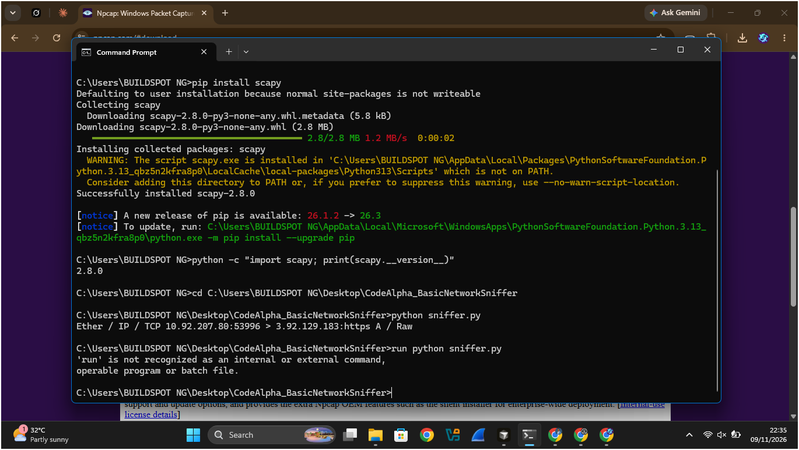
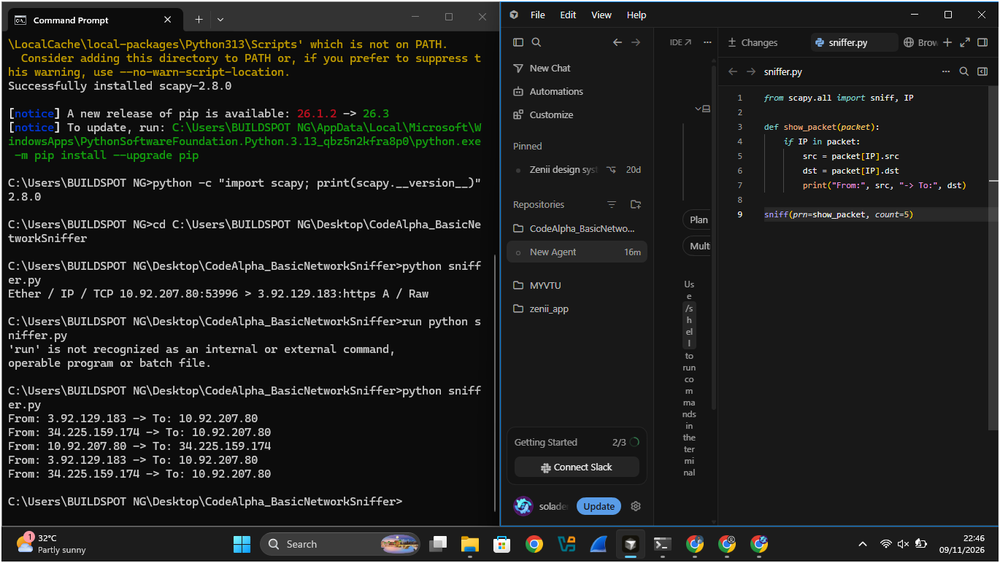
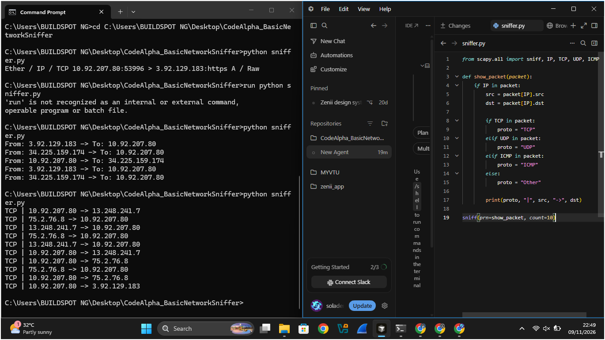
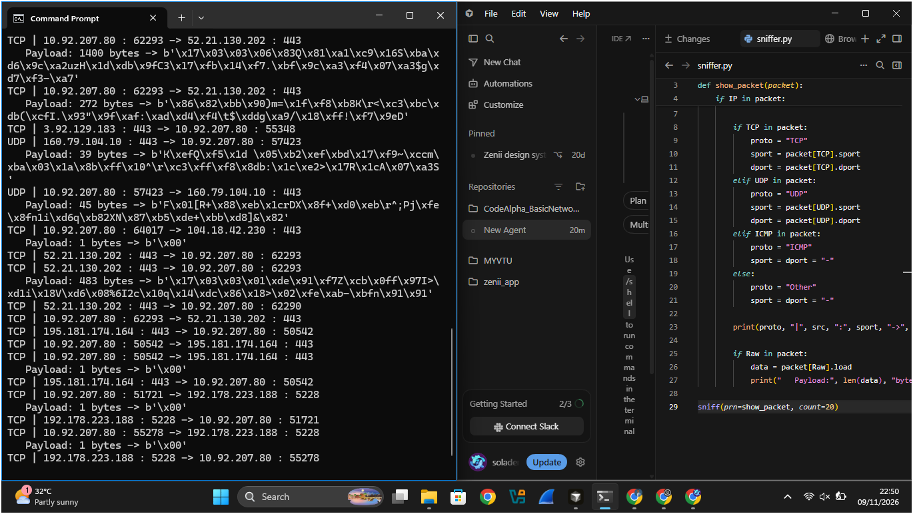
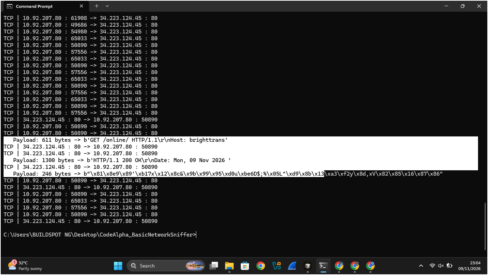
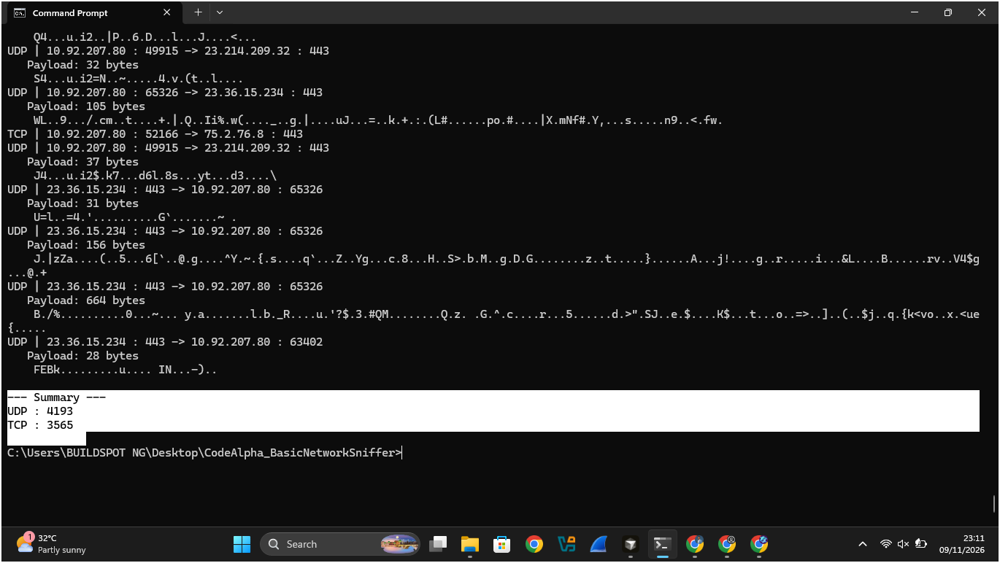

# CodeAlpha_BasicNetworkSniffer

Task 1 of my CodeAlpha Cyber Security Internship: a basic network sniffer
built in Python with Scapy.

## What it does
- Captures live network packets on my machine
- Shows source and destination IP addresses
- Identifies the protocol (TCP, UDP, ICMP)
- Shows source and destination ports
- Previews the payload as readable text
- Prints a protocol summary when stopped with Ctrl+C

## Requirements
- Python 3
- Scapy: `pip install scapy`
- Windows only: Npcap (npcap.com)
- Admin rights (packet capture needs them)

## How to run
1. Open Command Prompt as Administrator
2. `cd` into the project folder
3. `python sniffer.py`
4. Browse or run `ping` in another window to generate traffic
5. Press Ctrl+C to stop and see the summary

## How it works
Every packet is built in layers: Ethernet > IP > TCP/UDP > payload.
Scapy hands each captured packet to my `show_packet` function, which
checks which layers are present and reads the fields inside them.

## Sample output

### First captured packet

### Extracting IP addresses

### Detecting protocols

### Encrypted HTTPS payloads (unreadable)

### Plain HTTP payload (readable request and response)

### Summary after Ctrl+C

## What I observed
- HTTPS payloads look like random bytes because they are encrypted. Only
  the TLS record header is visible.
- On plain HTTP (neverssl.com) I could read the full request
  (`GET / HTTP/1.1`, Host) and response (`200 OK`).
- The HTTP response exposed the server software and version
  (`Server: Apache/2.4.68`), which attackers can use for fingerprinting.
- UDP outnumbered TCP in my capture, likely from QUIC/HTTP3 and DNS.
- Many TCP packets carry no payload: handshakes and ACK receipts.

## Limitations
- Only IP traffic is counted (ARP and similar are skipped)
- Encrypted traffic cannot be read
- ICMP did not show up in my test captures

## Disclaimer
For educational use only. Capture traffic only on networks you own
or have permission to monitor.
